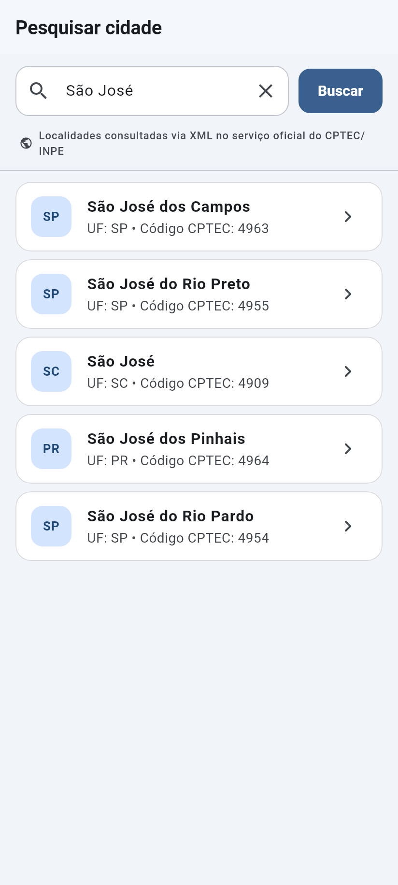
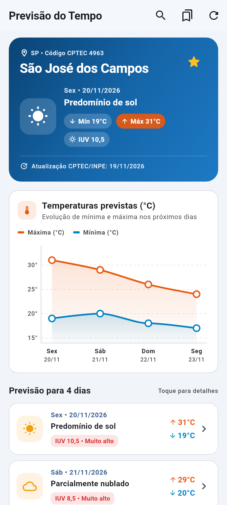
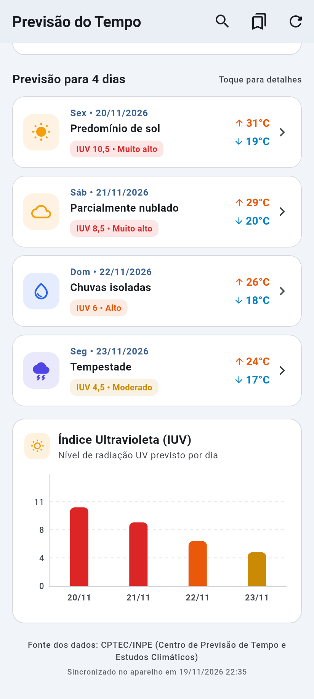
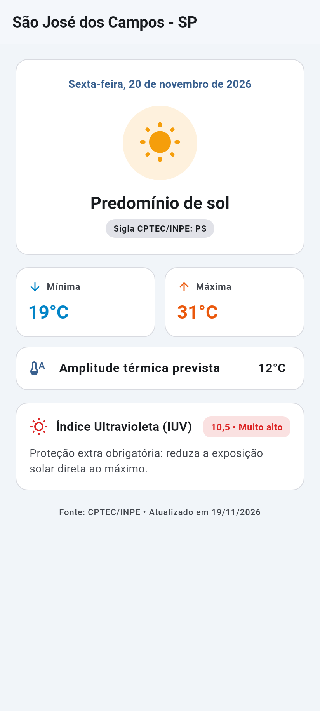
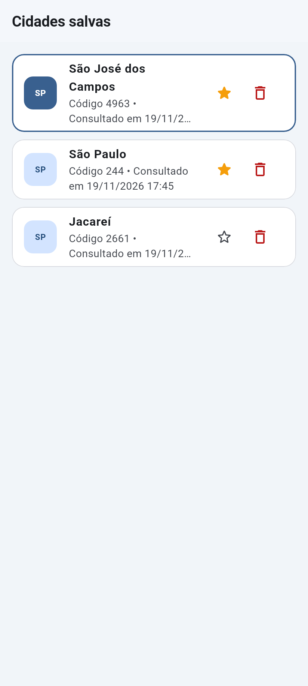
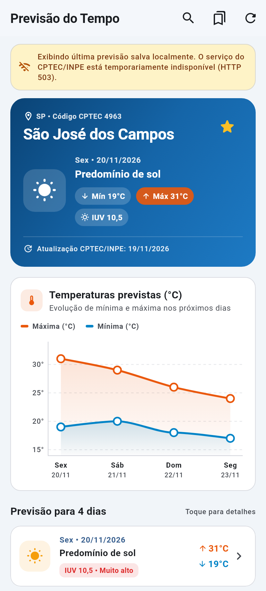

# Previsão do Tempo — CPTEC/INPE
**Atividade 2 — Programação para Dispositivos Móveis II**  
**Fatec — Prof. Arley**

---

## 👤 Aluno
* **Gustavo Silva** (Modalidade individual)

---

## 📱 Descrição das Funcionalidades Implementadas

Aplicativo móvel desenvolvido em **Flutter** e **Dart** para consultar a previsão do tempo de cidades brasileiras utilizando os serviços oficiais em **XML** do **CPTEC/INPE** (*Centro de Previsão de Tempo e Estudos Climáticos*).

### Principais Funcionalidades
1. **Pesquisa de Cidades (XML CPTEC/INPE)**:
   * Consulta localidades pelo nome via `GET https://servicos.cptec.inpe.br/XML/listaCidades?city={nome}`, removendo acentos automaticamente na consulta e decodificando corretamente respostas em `ISO-8859-1`.
   * Exibe **nome da cidade**, **unidade da federação (UF)** e o **identificador oficial retornado pelo CPTEC/INPE**, utilizado nas consultas subsequentes.
   * Apresenta cidades consultadas recentemente para acesso rápido e informa claramente quando nenhuma cidade é encontrada.
2. **Previsão do Tempo para 4 Dias**:
   * Consulta `GET https://servicos.cptec.inpe.br/XML/cidade/{codigo}/previsao.xml` e exibe todos os dias retornados.
   * Para cada dia, apresenta:
     * **Data da previsão** (dia da semana + formato `dd/MM/yyyy`).
     * **Temperatura mínima e máxima** em graus Celsius (`°C`).
     * **Descrição completa da condição do tempo** (conversão de todas as 40 siglas oficiais do CPTEC/INPE em descrições compreensíveis).
     * **Ícone representativo** e cor temática da condição meteorológica.
     * **Índice ultravioleta (IUV)** com classificação de risco e orientação de proteção, exibido quando disponível.
   * Exibe a **data de atualização** informada pelo serviço e identifica explicitamente o **CPTEC/INPE** como fonte dos dados.
3. **Gráficos Interativos (`fl_chart`)**:
   * **Gráfico de Temperaturas (°C)** (*LineChart*): evolução das temperaturas **mínima** e **máxima** ao longo dos dias previstos, com tooltips interativos.
   * **Gráfico de Índice Ultravioleta (IUV)** (*BarChart*): visualização por dia colorida conforme a escala oficial de risco UV (com aviso adequado quando o IUV não é disponibilizado pelo serviço).
4. **Navegação entre Telas**:
   * **Tela Principal (`TelaPrevisao`)**: cabeçalho meteorológico, gráficos, lista dos 4 dias, atualização manual (AppBar e *pull-to-refresh*) e selo de fonte CPTEC/INPE.
   * **Pesquisa de Cidades (`TelaPesquisaCidades`)**: busca em tempo real no CPTEC/INPE e lista de recentes.
   * **Cidades Salvas (`TelaCidadesSalvas`)**: gerenciamento das cidades persistidas localmente, favoritos e exclusão com confirmação.
   * **Detalhes do Dia (`TelaDetalheDia`)**: visão ampliada da condição do tempo, sigla oficial CPTEC, amplitude térmica e detalhamento do IUV.
5. **Tratamento de Erros e Resiliência**:
   * Indicadores de carregamento durante consultas HTTP.
   * Tratamento de falhas de conexão, tempo esgotado, indisponibilidade (HTTP 5xx/429), XML malformado, respostas vazias e tags literais `"null"` ou ausentes sem encerrar o aplicativo.
   * Fallback automático para o último cache salvo localmente caso a atualização falhe, exibindo aviso claro ao usuário.

---

## 📸 Capturas de Tela

| Pesquisa de Cidades (XML CPTEC/INPE) | Previsão e Gráfico de Temperaturas (°C) | Previsão de 4 Dias e Gráfico IUV |
| :---: | :---: | :---: |
|  |  |  |

| Detalhes do Dia | Cidades Salvas (SQLite) | Resiliência Offline (Cache Local) |
| :---: | :---: | :---: |
|  |  |  |

---

## 💾 Estratégia de Persistência Local

O aplicativo utiliza **SQLite** local (`sqflite`) no arquivo privado `previsao_tempo.db` com integridade referencial ativa (`PRAGMA foreign_keys = ON`) e duas tabelas relacionadas:

* **`cidades_salvas`**: armazena o código oficial CPTEC/INPE (`id` como chave primária), `nome`, `uf`, indicador de `favorita`, indicador de cidade `selecionada`, timestamp da última consulta (`ultima_consulta`), data de atualização reportada pelo CPTEC (`atualizacao_cptec`) e momento local da última sincronização (`atualizado_em`).
* **`previsoes_cache`**: armazena os registros diários da última previsão de 4 dias obtida para cada cidade (`cidade_id`, `data_previsao`, `sigla_tempo`, `minima`, `maxima` e `iuv`), com chave estrangeira `ON DELETE CASCADE` referenciando `cidades_salvas(id)`.

### Fluxo de Cache e Sincronização
1. **Abertura rápida**: ao iniciar, o app carrega a última cidade selecionada e exibe imediatamente os dados armazenados localmente enquanto solicita uma atualização silenciosa no CPTEC/INPE.
2. **Atualização atômica**: quando o CPTEC/INPE responde com sucesso, a cidade e seus dias de previsão são gravados dentro de uma transação SQLite (preservando o status de favorita).
3. **Resiliência offline**: se não houver internet ou o serviço CPTEC/INPE estiver indisponível, o aplicativo preserva a visualização da última previsão salva em cache e exibe um banner informando o ocorrido.
4. **Gerenciamento pelo usuário**: na tela **Cidades salvas**, o usuário pode alternar entre localidades, favoritar cidades ou removê-las (excluindo também o cache associado em cascata).

---

## 🌐 Serviço Utilizado (CPTEC/INPE — XML)

* **Pesquisa de localidades**:  
  `GET https://servicos.cptec.inpe.br/XML/listaCidades?city={nome}`
* **Previsão estendida de 4 dias**:  
  `GET https://servicos.cptec.inpe.br/XML/cidade/{codigo}/previsao.xml`

---

## 📦 Bibliotecas Utilizadas

| Biblioteca | Finalidade |
| --- | --- |
| [`http`](https://pub.dev/packages/http) (`^1.6.0`) | Requisições HTTP ao serviço oficial do CPTEC/INPE com decodificação de bytes `ISO-8859-1`. |
| [`xml`](https://pub.dev/packages/xml) (`^6.5.0`) | Interpretação segura e estruturada dos documentos XML retornados pelo CPTEC/INPE. |
| [`sqflite`](https://pub.dev/packages/sqflite) (`^2.4.1`) | Persistência local de cidades, favoritos e cache de previsões em banco SQLite. |
| [`path`](https://pub.dev/packages/path) (`^1.9.1`) | Construção segura do caminho do arquivo `previsao_tempo.db`. |
| [`fl_chart`](https://pub.dev/packages/fl_chart) (`^1.3.1`) | Renderização dos gráficos interativos de temperaturas mínima/máxima (*LineChart*) e índice UV (*BarChart*). |
| `flutter_localizations` | Suporte ao idioma português (`pt_BR`). |
| [`sqflite_common_ffi`](https://pub.dev/packages/sqflite_common_ffi) *(dev)* | Execução dos testes automatizados de persistência SQLite. |
| [`flutter_lints`](https://pub.dev/packages/flutter_lints) *(dev)* | Regras de análise estática com `flutter analyze`. |

---

## 🚀 Instruções para Executar o Projeto

### Pré-requisitos
* **Flutter SDK** (3.27 ou superior / Dart `>=3.6.0`)
* Emulador Android/iOS ou dispositivo físico com depuração USB ativada
* Conexão com a internet para consultas ao serviço CPTEC/INPE

### Passo a passo
1. Clone o repositório:
   ```bash
   git clone https://github.com/GustavoReis-xml/previsao-tempo.git
   cd previsao-tempo
   ```
2. Instale as dependências:
   ```bash
   flutter pub get
   ```
3. Execute a análise estática e os testes automatizados:
   ```bash
   flutter analyze
   flutter test
   ```
4. Execute o aplicativo:
   ```bash
   flutter run
   ```
